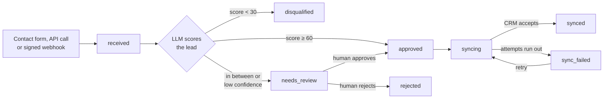

# FastAPI LLM Lead Qualifier

[](https://github.com/muneebulhassanpak/fastapi-llm-lead-qualifier/actions/workflows/ci.yml)
[](https://lead-qualification-api-h4sy.onrender.com/docs)


[](LICENSE)

A FastAPI service that scores incoming sales enquiries with an LLM, sends the uncertain ones to a human, and syncs approved leads to a CRM. Retries, idempotency and an audit trail are built in.

**[Live API docs](https://lead-qualification-api-h4sy.onrender.com/docs)** · [How it works](#how-it-works) · [Features](#features) · [Tech stack](#tech-stack) · [Run locally](#run-locally)

> **Status:** v1 is live. Approved leads sync to a built-in mock CRM; a real CRM adapter (HubSpot) is next. This is a personal portfolio project, not client work.

## Live demo

Open the [API docs](https://lead-qualification-api-h4sy.onrender.com/docs), click **Authorize**, and paste this public demo key:

```
lq_live_1f66cc24_22Wt_4qqAY3HB4ubOPU0tQHEDtPs2w3PGpSdhNdnqxY
```

- The key only sees the demo tenant, which has eight sample leads covering every status.
- Try `POST /v1/leads`. Claude scores the lead and it reaches its final status within seconds.
- It runs on Render's free plan, so after 15 idle minutes the first request can take up to a minute while the service wakes.
- Limits keep it cheap: 20 writes and 120 reads per minute per key, 50 model calls per day, and leads you create are deleted after 7 days.

## How it works



1. A lead arrives through `POST /v1/leads` or a signed webhook. The API answers `202` at once and queues a job in the same database transaction.
2. A background worker asks the LLM for a score, a confidence and a reason, then routes the lead using configurable thresholds.
3. Leads in `needs_review` wait for a person to approve or reject them through the API.
4. Approved leads are pushed to the CRM, with retries and backoff when it fails.

Every status change is checked against a single transition table and written to an append-only audit log.

## Features

### Reliability

- **Idempotent writes.** Send an `Idempotency-Key` header and a repeated request returns the original lead instead of creating a duplicate. Reusing a key with a different body is rejected with `409`. Keys last 24 hours.
- **Durable job queue in Postgres.** No Redis or broker needed. Workers claim jobs with `FOR UPDATE SKIP LOCKED`, so two workers never run the same job.
- **Retries with exponential backoff and jitter.** Starts at 5 s, capped at 10 minutes, up to 5 attempts, and honours the CRM's `Retry-After`.
- **Dead-letter state.** When attempts run out the lead moves to `sync_failed` with the last error recorded, and one API call retries it.
- **Crash recovery.** A job whose worker died mid-run is picked up again after a 5-minute lock timeout.
- **Transactional enqueue.** A lead and its job are saved together or not at all, so no lead is lost and no job points at nothing.
- **Duplicate-safe CRM sync.** Records are upserted by our lead ID, so a retry never creates a second CRM record. Every attempt is stored.

### LLM qualification

- **Structured outputs.** The model returns a typed score, confidence and reason, validated with Pydantic. No parsing free text.
- **Confidence-aware routing.** High scores are approved, low scores disqualified, and anything uncertain goes to a person.
- **Prompt-injection resistant.** Lead text is passed as data, never mixed into the instructions, and live tests try injection attacks against the real model.
- **Cost controls.** A per-tenant daily cap on model calls, and token usage recorded per tenant per day.
- **Swappable providers.** Anthropic (default `claude-haiku-5-5`), OpenAI, or an offline mock for tests and local work.

### Human review

- **Approve, reject and retry endpoints**, with an optional note and score override on approval.
- **Safe under concurrency.** Each action locks the lead row. Two people acting at once get one success and one `409` showing the current status.
- **Full audit trail.** Every action records which API key made it.

### Security

- **Multi-tenant isolation.** Every query is scoped to the caller's tenant, so one tenant can never see another's leads.
- **Hashed API keys.** Only an HMAC-SHA256 of each key, with a server-side pepper, is stored. The key is shown once and can be revoked.
- **Signed webhooks.** HMAC signatures with a 5-minute replay window, a generic format plus Tally forms, deduplication by event ID for 72 hours, and a 64 KB body limit.
- **Encrypted webhook secrets.** Secrets are stored encrypted at rest (Fernet).
- **Rate limiting.** Per-key limits for reads and writes, with `X-RateLimit-*` headers and `429` plus `Retry-After`. Webhooks only count once the signature is valid.
- **Fail-fast config.** In production the app refuses to start without its secrets.

### Observability and operations

- **Request IDs** (`X-Request-ID`) on every response and in every log line.
- **Structured JSON logs** with job, lead and attempt details.
- **One error format** for every error response, including the request ID.
- **Health check** at `/v1/health` that also checks the database.
- **Stats endpoint** with lead counts by status and source and the average score.
- **Automatic cleanup** of old demo data, plus an admin CLI for tenants, keys, webhooks and cleanup.

## Tech stack

| Layer | Technology |
|---|---|
| API | **FastAPI**, **Pydantic v2**, OpenAPI docs |
| Language | **Python 3.12**, managed with **uv** |
| Database | **PostgreSQL 16**, **SQLAlchemy 2** (async) with **asyncpg** |
| Migrations | **Alembic** |
| Background jobs | Custom Postgres queue (`SKIP LOCKED`) in the API process |
| LLM | **Anthropic Claude** via the official SDK; OpenAI optional |
| Security | HMAC-SHA256 key hashing, **cryptography** (Fernet, HKDF) |
| Logging | **structlog** (JSON) |
| CLI | **Typer** |
| Testing | **pytest** with real Postgres, coverage |
| Code quality | **ruff**, **mypy** (strict), pre-commit |
| Containers | **Docker** (multi-stage, non-root), Docker Compose |
| CI | **GitHub Actions**, CodeQL, Dependabot |
| Hosting | **Render** (Blueprint as code), **Neon** serverless Postgres |

## Engineering quality

- **360 tests with 98% coverage**, run against a real Postgres database, not mocks.
- **Strict type checking** with mypy on the app, tests and scripts.
- **Seven required CI checks** on every PR: lint, type check, tests, Docker build and smoke test, migrations (upgrade, downgrade, drift check), PR title, and commit messages.
- **Every commit passes on its own**, and history follows [Conventional Commits](https://www.conventionalcommits.org/).
- **Deploys only from `main`** after CI passes. Migrations run on start and are written to stay compatible with the version still serving traffic.

## API overview

| Method | Path | Purpose |
|---|---|---|
| `GET` | `/v1/health` | Liveness and database check |
| `POST` | `/v1/leads` | Create a lead (`202`, optional `Idempotency-Key`) |
| `GET` | `/v1/leads` | List leads with filters and cursor pagination |
| `GET` | `/v1/leads/{id}` | Lead detail with score, CRM state and audit trail |
| `POST` | `/v1/leads/{id}/approve` | Approve a lead in review |
| `POST` | `/v1/leads/{id}/reject` | Reject a lead in review |
| `POST` | `/v1/leads/{id}/retry` | Retry a failed sync or qualification |
| `POST` | `/v1/webhooks/{provider}/{endpoint_id}` | Receive a signed webhook |
| `GET` | `/v1/stats` | Lead counts and average score |

Full request and response schemas are in the [live docs](https://lead-qualification-api-h4sy.onrender.com/docs).

## Run locally

```bash
cp .env.example .env
docker compose up --build
docker compose exec api python -m app.cli create-tenant --name "Demo"   # copy the printed key
```

Then open <http://localhost:8000/docs>, click **Authorize**, paste the key, and try `POST /v1/leads`. Without an LLM key the offline mock provider scores leads.

- Development setup, tests and conventions: [CONTRIBUTING.md](CONTRIBUTING.md)
- Deployment: [docs/deploy.md](docs/deploy.md)
- Changes: [CHANGELOG.md](CHANGELOG.md)

## License

[MIT](LICENSE)
